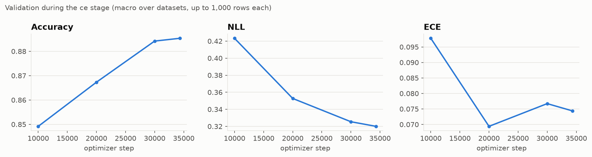
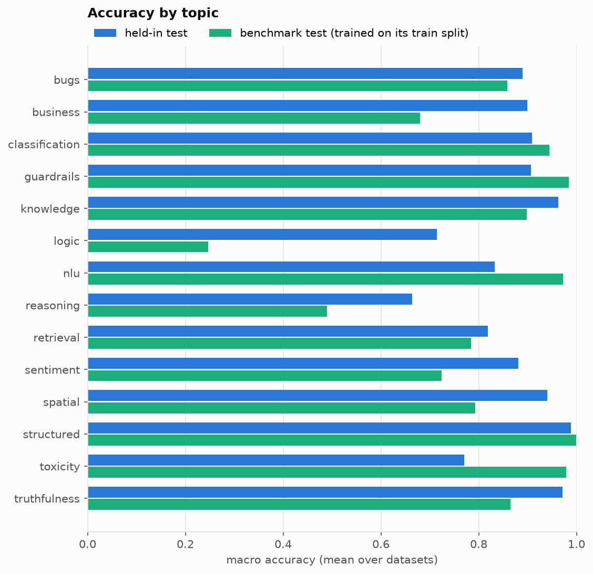
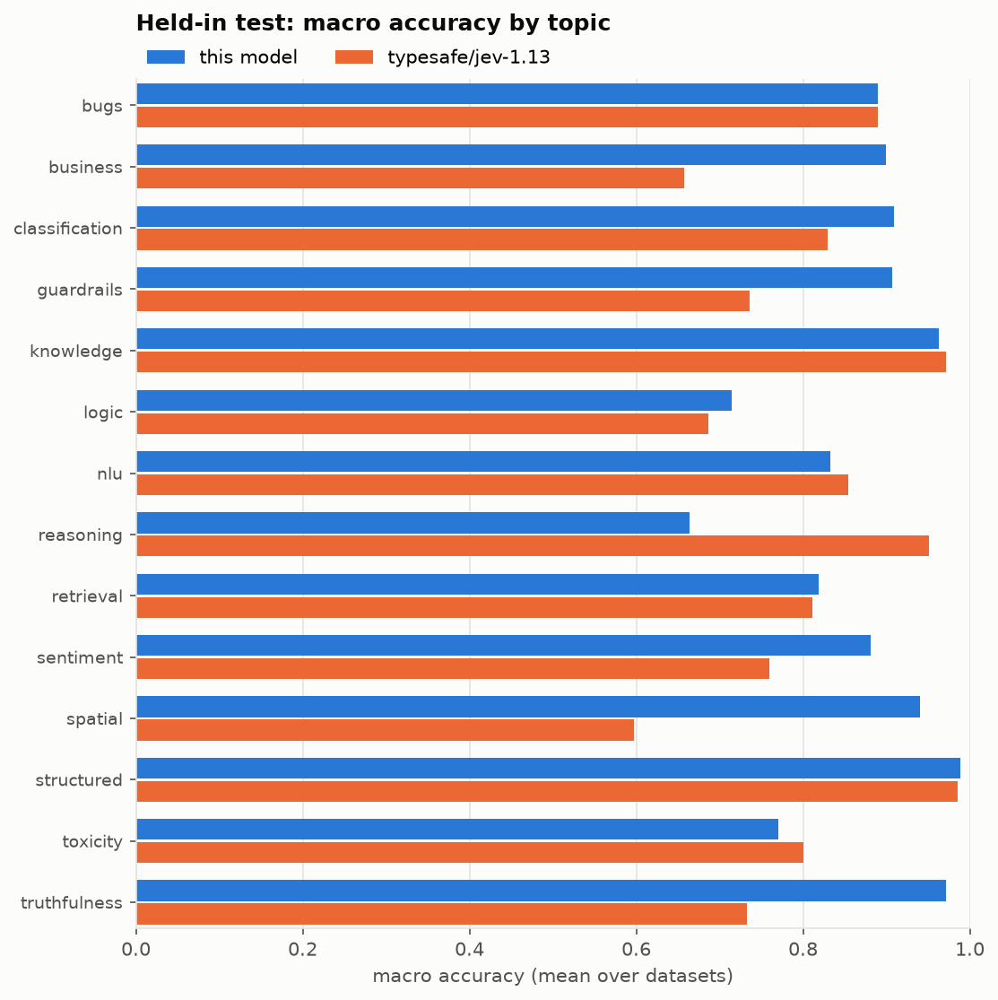
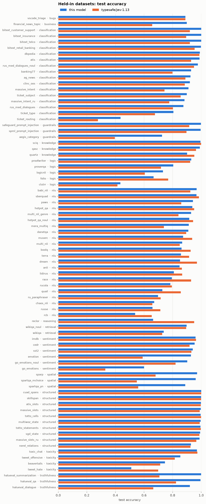
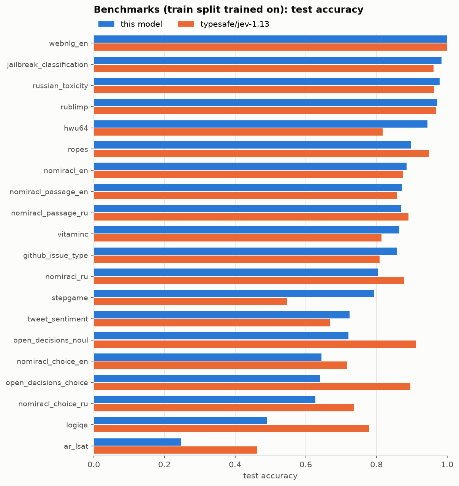

# jev pointer, all data (Qwen3.5-2B, run 20261018-160511)

A "system one" model. It reads a **state** (a context), a **question** and a list of **options**, and in one
forward pass returns a probability for every option. It is meant for classification, routing, extraction checks,
NLI, guardrails and reading comprehension, where the answer follows from the text it is given. It is not meant to
answer from world knowledge.

> **This is the final model, trained on all data, benchmarks included.** It was trained with
> `train_on_benchmark`, so the train splits of the 20 benchmark datasets were part of its training mix. Its
> benchmark scores therefore measure fit to tasks it has seen, **not** transfer to new ones. For transfer
> numbers, see the held-out run [`20261017-192041`](#against-the-held-out-run-20261017-192041)
> ([run files](https://github.com/SergeyBazhmin/krasivo-jev/tree/v0.1.0/runs/pointer/20261017-192041),
> [model](https://huggingface.co/bizhmans/jev-pointer-no-bench-bf16)), which is the same
> recipe without the benchmarks.

- **Base model:** [Qwen/Qwen3.5-2B-Base](https://huggingface.co/Qwen/Qwen3.5-2B-Base). LoRA rank 16 on every
  attention, linear-attention and MLP projection, plus a 256-dim pointer head
  ([`src/jev_model/pointer/`](https://github.com/SergeyBazhmin/krasivo-jev/tree/v0.1.0/src/jev_model/pointer)).
- **Languages:** English and Russian.
- **Questions:** `noul` (yes/no) and `choice` (any number of options; there is no fixed slot count).
- **Training:** the `ce` stage only, 34,315 optimizer steps (2 epochs over 100 datasets).
- **Run:** [`runs/pointer/20261018-160511`](https://github.com/SergeyBazhmin/krasivo-jev/tree/v0.1.0/runs/pointer/20261018-160511) in the training repo: config,
  training history and test scores.
- **Headline:** on the test splits of the 80 core datasets, macro accuracy is **0.877**, NLL 0.359 and ECE 0.043.
  On the test splits of the 20 benchmark datasets (whose train splits it trained on), macro accuracy is **0.791**,
  NLL 0.549 and ECE 0.064.

## How it works

The sample is laid out as one causal sequence. The delimiters reuse rarely used Qwen special tokens, so no
vocabulary rows are added:

```
<state> state <q> question <opt> option 1 </opt> <opt> option 2 </opt> ... <decide>
```

The pointer head projects the hidden state at `<decide>` and the hidden state at each `</opt>` to 256 dimensions.
An option's logit is their scaled dot product. A softmax over the options, at the fitted temperature (0.626 for
this run), gives the probabilities. Because the logit comes from each option's own text, any number of options
works and the option labels can be arbitrary. Sequences are cut to 8,192 tokens: a longer state loses its middle.

Attention is plain causal, so an option can see the options before it, and the output can depend somewhat on
option order. Training shuffles the options on every draw so that the model can't learn a position prior.

The design is adapted from [kev](https://github.com/jaredpalmer/kev). There is one question per sequence and no
option isolation, which suits the linear-attention (Gated DeltaNet) layers of Qwen3.5.

## Training

| setting | value |
|---|---|
| objective | focal loss (γ = 2) over the option distribution, which supports soft labels |
| optimizer steps | 34,315 (2 passes over the training set, `sized` sampling) |
| batch | up to 8,192 padded tokens × 2 accumulation steps |
| learning rate | 2e-4, 500 warmup steps, weight decay 0.01 |
| precision | bf16 base weights and autocast; LoRA and head in float32 |
| augmentation | options reshuffled on every draw. With p = 0.2, some wrong options are dropped (so the option count doesn't reveal the dataset). With p = 0.1, the true option's text is replaced by "None of the above" |
| max length | 8,192 tokens (the held-out run used 4,096) |
| model selection | every 10,000 steps, on up to 1,000 validation rows per dataset; the weights with the best macro NLL are kept, then one temperature is fitted on the whole validation partition |

With `sized` sampling, each pass shuffles the whole training set and packs it into token-budget batches. Every
sample is seen once per pass, so the datasets are mixed in proportion to their size.

To train it from scratch, you need at least 4 A100 GPUs; this run takes about 12–13 hours on 4 of them. Build the
data, then train with DDP from this run's config:

```bash
uv run jev prepare all --max-samples 25000 -j 8
uv run accelerate launch --multi_gpu --num_processes 4 -m jev_model.cli train pointer \
  -c runs/pointer/20261018-160511/config.json -s data_dir=data  # the saved data_dir is the training machine's path
```



## Revisions

The pinned versions behind this model.

| what | revision |
|---|---|
| base model | [Qwen/Qwen3.5-2B-Base](https://huggingface.co/Qwen/Qwen3.5-2B-Base/tree/b1485b2fa6dfa1287294f269f5fb618e03d52d7c) @ `b1485b2fa6dfa1287294f269f5fb618e03d52d7c`, the snapshot merged into these weights at export |
| training code | [`krasivo-jev` @ `ee22754`](https://github.com/SergeyBazhmin/krasivo-jev/tree/ee227549a960b223ec5e8319aa294bc19c4c031e), the last commit before the run started (2026-10-18 16:05 +0300). The run doesn't record its commit |
| export code | [`krasivo-jev` @ `0b3be4c`](https://github.com/SergeyBazhmin/krasivo-jev/tree/0b3be4c4da38bc131478e9a1f606077c2dc75b4f) |
| libraries | torch 2.14.0, transformers 5.17.0, peft 0.21.1, accelerate 1.15.0, datasets 5.0.1, huggingface-hub 1.33.0 ([`uv.lock`](https://github.com/SergeyBazhmin/krasivo-jev/blob/v0.1.0/uv.lock)) |
| serving | `vllm/vllm-openai:v0.17.1` ([`docker/vllm.Dockerfile`](https://github.com/SergeyBazhmin/krasivo-jev/blob/v0.1.0/docker/vllm.Dockerfile)) |
| training data | built by `jev prepare` from the source datasets listed in the metadata, at their Hub `main` as of 2026-10-18. The source revisions weren't recorded |

To load the base model at the same revision, pass `revision="b1485b2fa6dfa1287294f269f5fb618e03d52d7c"` to
`from_pretrained`/`snapshot_download`.

## Data

All data is converted by the [`krasivo-jev`](https://github.com/SergeyBazhmin/krasivo-jev/tree/v0.1.0) pipeline ([`src/jev_datasets/`](https://github.com/SergeyBazhmin/krasivo-jev/tree/v0.1.0/src/jev_datasets)) into one format:
`state -> question -> options -> label`. The label is a probability distribution over the options: one-hot, or
annotator vote shares for sets such as ChaosNLI. Sources, subsets and rows that need outside knowledge were
dropped. Examples: SciQ keeps only rows that have a support passage, and BBH leaves out its knowledge-heavy tasks.
MMLU, ARC, OpenBookQA, CommonsenseQA, HellaSwag and WinoGrande are excluded for this reason. Each dataset uses
about 5 paraphrases of its question and of its instruction, picked deterministically per sample.

The model trained on the train splits of all 100 datasets: the 80 core datasets and the 20 benchmarks. They
cover 14 topics: bugs, business, classification, guardrails, knowledge, logic, nlu, reasoning, retrieval,
sentiment, spatial, structured, toxicity and truthfulness. The full list, with sources, is in the tables below.
The splits are the same as in the held-out run, so test rows are identical across the two runs.

### Split method

Each dataset is saved with exactly `train`, `validation` and `test` splits, built as follows:

1. **Canonical names.** `dev`/`val` become `validation`; unknown split names become `train`.
2. **Disjoint contexts.** Rows are grouped by source document (an explicit `group` key when one document yields
   several passages or turns), or otherwise by a hash of their context (`state`, or `question` when there is no
   state). Each group moves whole into the first split it appears in, checked in the order test, validation,
   train. So **no context appears in two splits**, and a test passage is never trained on through another
   question about it. Exact duplicate rows are dropped, and the held-out copy is kept.
3. **Missing splits.** A missing validation or test split is carved from train by a hash of the group, 5% each.
   A source with no train split at all is re-split 80/10/10.
4. **Caps.** Each split is capped with a seeded random sample. This build used 25,000 rows per split.
5. **Sources that share data.** Many logic and spatial collections bundle each other (for example, SpaRP
   includes StepGame, and RuleCollection bundles ProofWriter and LogicNLI). Each underlying set is taken from
   one source only, so a benchmark's rows can't leak in through another dataset's train split.

Every step is deterministic, seeded from the sample content.

### Benchmarks

20 datasets are marked as **benchmarks**. In the normal recipe they are held out completely. **This model trained
on their train splits** (`train_on_benchmark`); only their validation and test splits stay unseen. They
are OpenDecisions (split into `noul` and `choice`), plus one converter per topic chosen by a seeded draw:
`ar_lsat`, `github_issue_type`, `hwu64`, `jailbreak_classification`, `logiqa`, the six `nomiracl_*` sets, `ropes`,
`rublimp`, `russian_toxicity`, `stepgame`, `tweet_sentiment`, `vitaminc` and `webnlg_en`. For this model their test
scores are in-distribution, just like the core datasets. The training-time validation that picked the checkpoint
used only the 80 core datasets.

## Evaluation

All scores are on the **test** split. Each row is scored by the option with the highest probability, at the
fitted temperature:

- **accuracy**: the argmax option is a correct one.
- **NLL**: the cross-entropy of the predicted distribution against the label distribution.
- **ECE**: expected calibration error of the top-option confidence, with 15 equal-width bins.
- **macro**: the mean over datasets, so every dataset counts the same however large it is.

The comparison model is TypeSafe's hosted `typesafe/jev-1.13`, called through its `system_one` API and scored on
the same test rows. jev-1.13's training data is not known, so for that model neither the held-in sets nor
the benchmarks are guaranteed to be held out.

In the tables and plots, "held-in" means the 80 core datasets. "Benchmarks" are the 20 benchmark datasets,
whose train splits this model also trained on.

| | datasets | rows | accuracy | NLL | ECE | jev-1.13 accuracy | jev-1.13 NLL | jev-1.13 ECE |
|---|---:|---:|---:|---:|---:|---:|---:|---:|
| held-in test | 80 | 294,408 | **0.877** | **0.359** | **0.043** | 0.829 | 0.882 | 0.080 |
| held-in, `noul` | 14 | | **0.935** | **0.165** | **0.030** | 0.858 | 0.326 | 0.052 |
| held-in, `choice` | 66 | | **0.864** | **0.400** | **0.046** | 0.823 | 1.000 | 0.085 |
| benchmarks | 20 | 102,175 | 0.791 | **0.549** | **0.064** | **0.825** | 0.748 | 0.067 |
| benchmarks, `noul` | 6 | | 0.856 | 0.304 | 0.064 | **0.896** | **0.254** | **0.051** |
| benchmarks, `choice` | 14 | | 0.763 | **0.654** | **0.065** | **0.795** | 0.960 | 0.074 |

All values are macro means over datasets; the better value in each pair is in bold.



### Against the held-out run (20261017-192041)

The [held-out run](https://github.com/SergeyBazhmin/krasivo-jev/tree/v0.1.0/runs/pointer/20261017-192041) is the same recipe without the benchmark train splits, and with a 4,096-token limit.

| macro on test | this run | held-out run |
|---|---:|---:|
| held-in accuracy / NLL / ECE | 0.877 / 0.359 / 0.043 | 0.879 / 0.351 / 0.041 |
| benchmark accuracy / NLL / ECE | **0.791 / 0.549 / 0.064** | 0.640 / 0.990 / 0.123 |

Adding the benchmarks costs nothing on the core datasets: every metric is within 0.01. The benchmarks improve on 19
of 20 sets, most on the ones the held-out run failed to transfer to: `rublimp` +0.47, `stepgame` +0.44,
`open_decisions_noul` +0.24, `russian_toxicity` +0.23. `logiqa` (0.490) and `ar_lsat` (0.247) stay near where they
were, so training on those formats did not help.

### Held-in datasets, against jev-1.13

This model beats jev-1.13 on 53 of 80 core datasets, and its macro NLL is less than half of jev-1.13's. The
pattern matches the held-out run. It gains on spatial QA (`spartqa_mchoice` +0.41, `spartqa_yn` +0.33,
`sparp` +0.29), emotion labels (`emotion` +0.34, `go_emotions` +0.27), `aegis_category` (+0.33) and
`halueval_summarization` (+0.29). It falls behind on multi-choice reading comprehension and argument reasoning
(`reclor` −0.29, `race` −0.14, `quail` −0.13, `dream` −0.12), on `tweet_hate` (−0.19), on `rcb` (−0.12) and on
`folio` (−0.10).





### Benchmarks, against jev-1.13



On the benchmarks this model wins 10 of 20 datasets, with `webnlg_en` tied at 0.999. jev-1.13 has the higher macro
accuracy (0.825 vs 0.791), but this model has the lower NLL and ECE. This model leads on `stepgame` (+0.25), `hwu64`
(+0.13), `tweet_sentiment`, `vitaminc` and `github_issue_type`. It trails on `logiqa` (−0.29), `open_decisions_choice`
(−0.26), `ar_lsat` (−0.22), `open_decisions_noul` (−0.19) and the `nomiracl` choice sets.

## Usage

The repo holds merged bf16 weights that vLLM can serve, plus the LoRA `adapter/` and `head.pt` for in-process
use. Both paths need the [`krasivo-jev`](https://github.com/SergeyBazhmin/krasivo-jev/tree/v0.1.0) package (`jev_model` and the `jev_vllm` plugins). Install it at the
[`v0.1.0`](https://github.com/SergeyBazhmin/krasivo-jev/releases/tag/v0.1.0) release, which matches these weights:

```bash
git clone https://github.com/SergeyBazhmin/krasivo-jev && cd krasivo-jev && git checkout v0.1.0
uv sync
```

```python
from jev_model.system_one import Choice, JevHolder, Noul

holder = JevHolder.from_pretrained("bizhmans/jev-pointer-bf16", revision="v0.1.0")
answers = holder.system_one(
    state="I was charged twice for my order. Please help.",
    questions={
        "billing": Noul(instructions="Is this about billing?"),
        "tone": Choice(instructions="What is the tone?", criteria={"angry": None, "calm": "polite"}),
    },
)
answers["billing"].noul  # P(yes)
answers["tone"].choice  # the likeliest key; also .confidence and .probabilities
```

```bash
uv run serve bizhmans/jev-pointer-bf16 -- --revision v0.1.0 --tokenizer-revision v0.1.0
# vLLM 0.17.1 + jev_vllm plugins in Docker, http://localhost:8080/pooling
curl localhost:8080/pooling -H 'Content-Type: application/json' -d '{"model": "pointer", "data": {
  "state": "I was charged twice. Please help.",
  "questions": {"billing": {"type": "noul", "instructions": "Is this about billing?"}}}}'
```

Code written against `typesafe-sdk` can call the served model through
[`jev_vllm.client.JevClient`](https://github.com/SergeyBazhmin/krasivo-jev/blob/v0.1.0/src/jev_vllm/client.py), which takes the same question types and returns the SDK's
`SystemOneResponse`. Swap the client to switch between them:

```python
from typesafe_sdk import Choice, Noul
from jev_vllm.client import JevClient

with JevClient() as client:  # http://localhost:8080, model "pointer"
    response = client.system_one(
        state="I was charged twice for my order. Please help.",
        questions={
            "billing": Noul(instructions="Is this about billing?"),
            "tone": Choice(instructions="What is the tone?", criteria={"angry": None, "calm": "polite"}),
        },
    )
response.nouls["billing"].noul, response.choices["tone"].choice
```

`AsyncJevClient` has the same `system_one`, awaited. vLLM batches concurrent requests itself, so `asyncio.gather` over
many calls keeps the GPU busy.

## Limitations

- The model is not a knowledge base. Questions whose answer is not in the state get confident-looking guesses.
- Option order can shift the probabilities slightly, because options attend causally to the ones before them.
- "None of the above" was trained only as an augmentation; the scores here don't measure it.
- Every reported score is in-distribution: no dataset here is unseen. Expect lower accuracy and worse calibration
  on new tasks; the held-out run's benchmark numbers (macro accuracy 0.640, ECE 0.123) are the better estimate.
- Multi-step logic (`ar_lsat`, `logiqa`) stays weak even after training on it.
- The training mix is weighted by dataset size, so large English sets dominate it.

## Per-dataset scores

`n` is the number of test rows. `type` is `noul` (yes/no) or `choice`.

